<!-- The banner and button alt text repeat the titles in LANGS in scripts/banner.py: change both together. -->
<picture>
  <source media="(prefers-color-scheme: dark)" srcset="./assets/banner-en-dark.svg">
  
</picture>

I build Go APIs and React interfaces for a logistics platform. 
In my portfolio, every technical challenge is a boss fight. **Up for it?**

<a href="https://portifolio-victor-novakoski.vercel.app"><picture><source media="(prefers-color-scheme: dark)" srcset="./assets/botao-forja-en-dark.svg"></picture></a>

[LinkedIn](https://www.linkedin.com/in/victor-novakoski-6b0163240/) · [Email](mailto:novakoski2021@gmail.com)

Projects: [Panda Cooking](https://github.com/Victor-Novakoski/panda-cooking-go-api) · Rastreia (coming soon)

The portfolio is in Portuguese · [Ler em português](https://github.com/Victor-Novakoski/Victor-Novakoski/blob/main/README.md)

