<!-- O alt do banner e do botão repete o title de LANGS em scripts/banner.py: mude os dois juntos. -->
<picture>
  <source media="(prefers-color-scheme: dark)" srcset="./assets/banner-dark.svg">
  
</picture>

Construo APIs em Go e interfaces em React para um sistema de logística. 
No meu portfólio, cada desafio técnico virou uma luta contra um chefe. **Topa encarar?**

<a href="https://portifolio-victor-novakoski.vercel.app"><picture><source media="(prefers-color-scheme: dark)" srcset="./assets/botao-forja-dark.svg"></picture></a>

[LinkedIn](https://www.linkedin.com/in/victor-novakoski-6b0163240/) · [E-mail](mailto:novakoski2021@gmail.com)

Projetos: [Panda Cooking](https://github.com/Victor-Novakoski/panda-cooking-go-api) · Rastreia (em breve)

[Read in English](https://github.com/Victor-Novakoski/Victor-Novakoski/blob/main/README.en.md)

